# REDSHIFT for the BBC Micro

An original flip-screen run-and-gun game for the BBC Micro (a Model B
with 16K of sideways RAM, or a Master 128), in 6502 assembly. It's whole:
five sectors, a boss, and two endings.

> Kharon-4, 2189. The colony's deep mine broke into the Prism, an alien
> engine that splits reality in two. The Red Phase is overrun by the
> Prism's war machines; the Blue Phase by its crystal swarm. Trooper Ash
> Calder wears the last working phase harness. Fight down through five
> sectors and shut the Prism off.

### ▶ [Play it in your browser](https://bbc.xania.org/?disc=github:mattgodbolt/redshift-beeb/redshift.ssd&autoboot)

A teletext title page, then five sectors of nine rooms each: THE LEACH
WORKS, from the LANDING ZONE down to the cage in the SKIP SHAFT; THE
MARSHALLING YARD, from the ENGINE SHED to the CRUSHER'S MOUTH; THE SUMP,
from the OUTFALL down THE PLUGHOLE; THE SPAR SEAMS, from THE MOTHER LODE
down to BORE NINE; and INSIDE THE PRISM, from FIRST FACET to THE HINGE,
and the end.
The cage loads each sector from the disc as it takes Ash down. Each **SHIFT** costs a phase cell. Blocks and enemies of
the other phase are dotted ghosts: you walk through them, and they can't
touch you. Green is always acid, the Sump's red water boils only in the
Red Phase, and in the Spar Seams the Blue's crystal grows and draws back.
A Drill Sergeant is armoured and dies only to a grenade: lob one from a
crate, or crouch under its fire and roll one at it. The music follows the
phase: listen to it change when you shift.

| Key | Does |
|---|---|
| Z / X (or ← →) | left / right |
| : (or ↑) | jump |
| / (or ↓) | crouch |
| RETURN | fire |
| SPACE | throw a grenade (crouching, roll it) |
| SHIFT | flip the phase |
| P | pause |
| ESCAPE | give the room up and start it again, for a life |
| M | music off / on |

## Sector 1, room by room

<table>
<tr><td></td>
<td></td></tr>
<tr><td></td>
<td></td></tr>
<tr><td></td>
<td></td></tr>
<tr><td></td>
<td></td></tr>
</table>

THE LEACH WORKS, where Ash starts, teaches one thing a room:

1. **LANDING ZONE.** Shoot the Trundler on the pad, hop the acid, and
   climb the girders over the pool to the way out.
2. **PUMP HOUSE.** A welded barricade blocks the corridor in the Red
   Phase, with a Gadfly beyond it to shoot under it. SHIFT, and in the
   Blue the barricade is a dotted ghost you walk through, while crystal
   ledges you couldn't stand on appear (above, the same moment in each
   phase).
3. **VAT ROW.** Blue crystal spans over the acid vats. The machines here
   belong to the Red, so in the Blue they're ghosts that can't touch you.
4. **THE PICKLE JAR.** A drop into a jar of acid, with Red plates across
   it: shift back, and the Gadfly over them is real again. Below, a
   Trundler in the drain has to be shot crouching.
5. **SETTLING TANKS.** A pack of fracture charges, and a cracked wall
   across the way on, with a Trundler behind it. One charge brings the
   whole wall down.
6. **FOREMAN'S HUT.** A Drill Sergeant holds the yard, and bolts spark off
   its armour. Lob a charge from a crate, or crouch under its fire and roll
   one. There's a trauma kit in the hut.
7. **THE CATWALKS** and 8. **SLURRY RUN.** Spending cells with care: Blue
   spans, Red plates, and Slivers that wake when you shift into their
   phase.
9. **SKIP SHAFT.** Down to THE CAGE, past a second sergeant. The cage takes
   Ash down to Sector 2.

## Sector 2, the Marshalling Yard

<table>
<tr><td>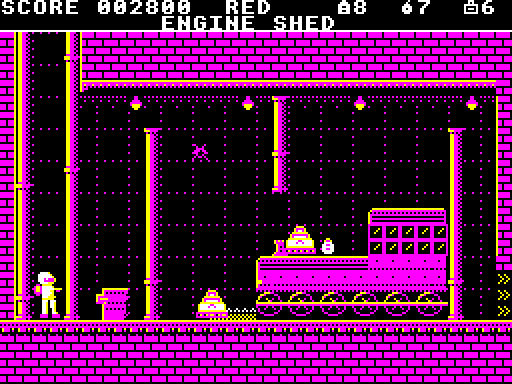</td>
<td>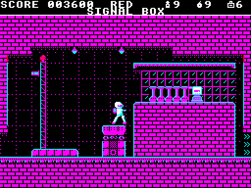</td></tr>
<tr><td>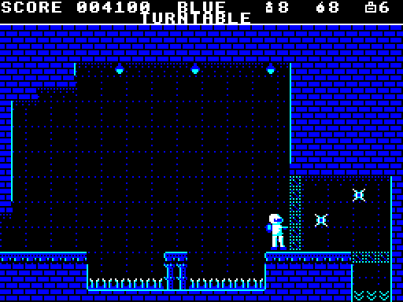</td>
<td>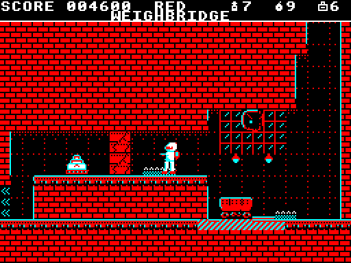</td></tr>
<tr><td>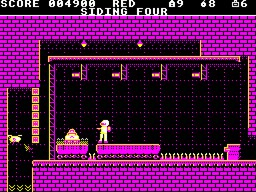</td>
<td>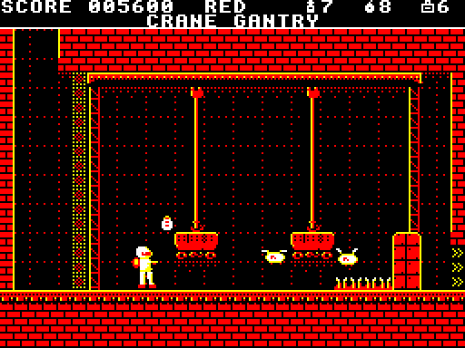</td></tr>
<tr><td>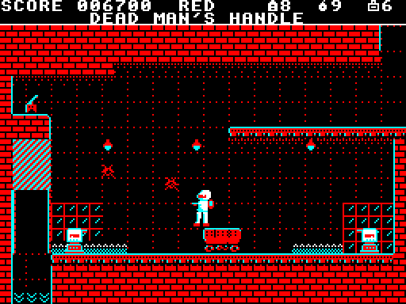</td>
<td>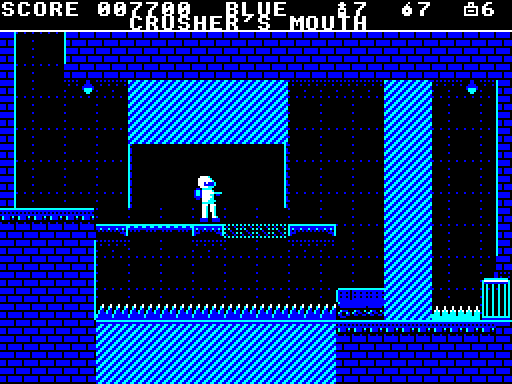</td></tr>
</table>

The ore railway's hub, and the machines' home ground. Red barricades
everywhere, so going round costs cells, and machinery that moves on the
beat, flickering just before it does, or when Ash throws a switch:

1. **ENGINE SHED.** Trundlers in numbers, around an engine on its running
   gear, and crystal and a Sliver in the Blue.
2. **SIGNAL BOX.** A Drill Sergeant up in its box, an ore truck to throw
   from, and room to lob in the box too.
3. **TURNTABLE.** Its deck turns end on to the line and back, over a pit of
   torn rails; Slivers beyond the barricade, and a welded hatch to drop
   through in the Blue.
4. **WEIGHBRIDGE.** A weigh plate that opens the gate to the siding, and
   jammed ore carts that only a grenade moves.
5. **SIDING FOUR.** A truck that drives itself over the spike gap, from one
   side to the other: ride it where it overlaps itself.
6. **CRANE GANTRY.** A load that drops on the beat, and a Drill Sergeant on
   the crane.
7. **BUFFER STOPS.** Both phases in turn, the Blue for the spans and the Red
   for the plates, then a truck that runs into the buffers: the step over
   them.
8. **DEAD MAN'S HANDLE.** A truck between two sergeants, and a press over
   the way down. Shoot the handle and it stops.
9. **CRUSHER'S MOUTH.** A beam under the jaw, which needs both phases and
   good timing, a press that opens only while the jaw is shut, and the cage
   down to Sector 3.

## Sector 3, the Sump

<table>
<tr><td>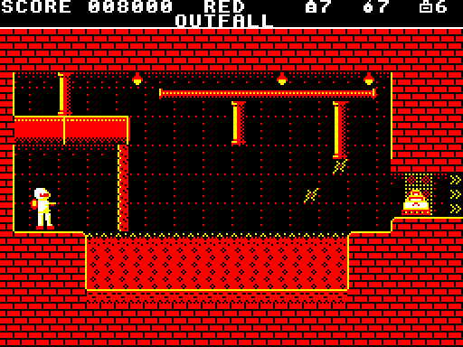</td>
<td>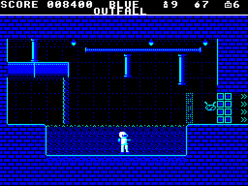</td></tr>
<tr><td>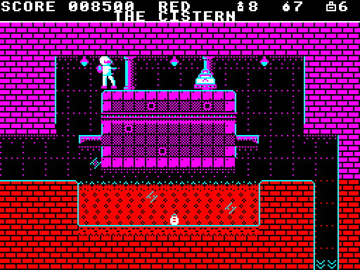</td>
<td>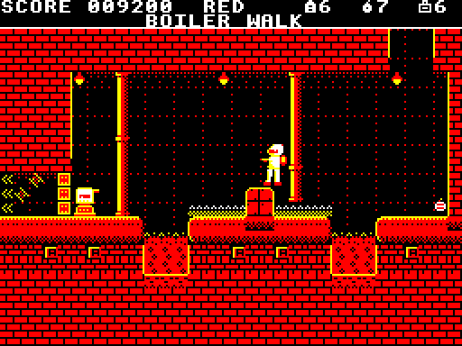</td></tr>
<tr><td>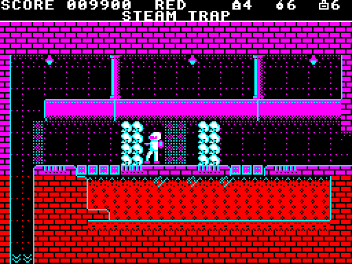</td>
<td>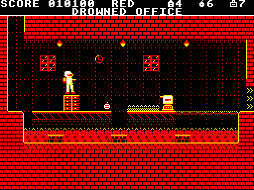</td></tr>
<tr><td>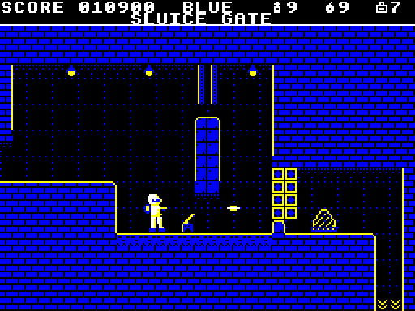</td>
<td>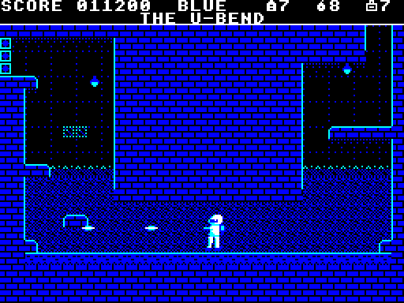</td></tr>
<tr><td>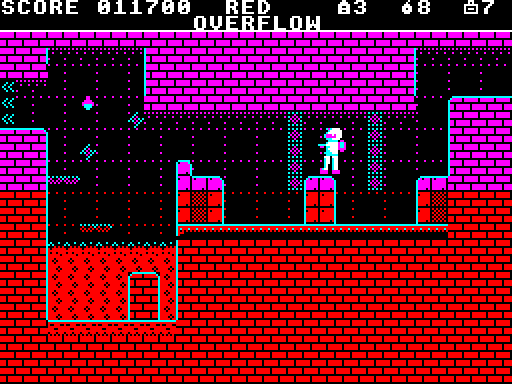</td>
<td>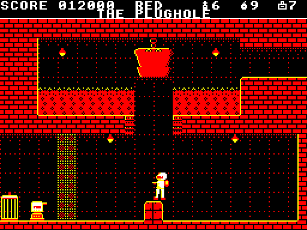</td></tr>
</table>

Every mine leaks, and the leaks all run here. In the Red Phase the sump
boils; in the Blue the swarm has drunk it, and its dry bed is the road, but
the Blue has its own walls, crystal and Slivers, and cells are few. Every
room takes both phases. A shift into the water, or right beside an enemy,
is refused. A Sliver wakes when you shift into the Blue and comes for you:
let it come level, and shoot it.

1. **OUTFALL.** The first lesson (above, in each phase). The sump boils
   across the room; in the Blue, down into its dry bed while two Slivers
   come across it, up onto the far landing, and back to the Red there,
   where crystal holds the way out, for the Trundler on the step above.
2. **THE CISTERN.** A full tank in the Red, and in the Blue an empty one,
   its floor the Red's plates, with a swarm in it that rises at you. Fight
   it from the walkway, not from the kerb, drop through the tank into the
   cellar, and leave through a wall that's the Blue's. A Gadfly in the
   cellar keeps a cell.
3. **BOILER WALK.** Boiler to boiler over the boiling gaps, and a Drill
   Sergeant: lob from the steam dome, or roll. Crystal on the boilers in
   the Blue, and the door is welded in the Red.
4. **STEAM TRAP.** Vents that steam in turn on the beat, flickering just
   before they change, with safe pockets between, in the Red. The Blue's
   blocks bar the corridor; its way is the dry bed, past a pack of Slivers
   to a cell, and up into the last pocket before the last vent.
5. **DROWNED OFFICE.** Along the shelves over the flood: a Trundler, a
   filing cabinet to hide behind and lob from, and a sergeant at the end
   of the shelves, against a wall of the Red's. Past it, only the Blue's
   span reaches the door.
6. **SLUICE GATE.** The gate's handle is at its foot, under the water in
   the Red. Throw it in the Blue and the gate lifts and the sump drains, in
   both phases.
7. **THE U-BEND.** The bend holds boiling water to the same level in both
   legs: through it in the Blue, and back to the Red above the waterline
   for the welded plate up to the way out.
8. **OVERFLOW.** The sump floods the walkway on the beat: hop from depth
   post to depth post over it, or walk it while it's down. The Blue's
   baffles hang over the walkway, so it's the Red's. Then the basin, where
   only the Blue's steps climb to the way out.
9. **THE PLUGHOLE.** Down the plughole in the Blue while the plug's drawn
   up; back to the Red on the crate under it, out of a sergeant's fire; and
   the cage down to Sector 4.

## Sector 4, the Spar Seams

<table>
<tr><td>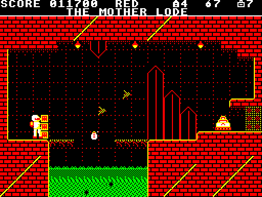</td>
<td>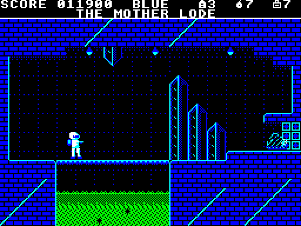</td></tr>
<tr><td>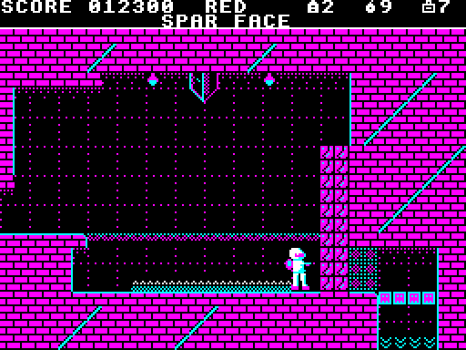</td>
<td>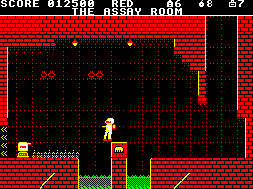</td></tr>
<tr><td>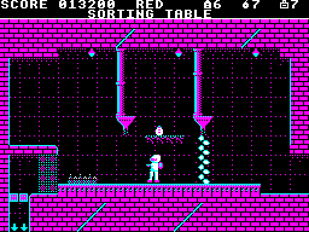</td>
<td>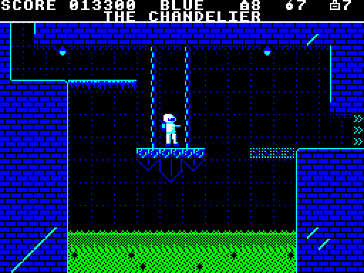</td></tr>
<tr><td>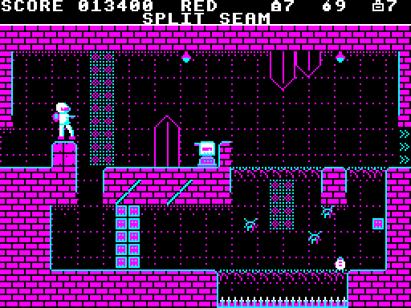</td>
<td>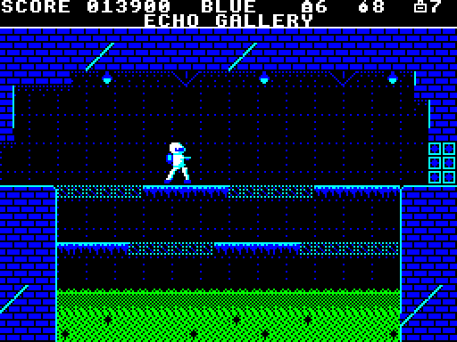</td></tr>
<tr><td>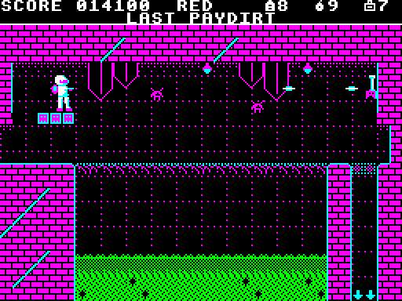</td>
<td>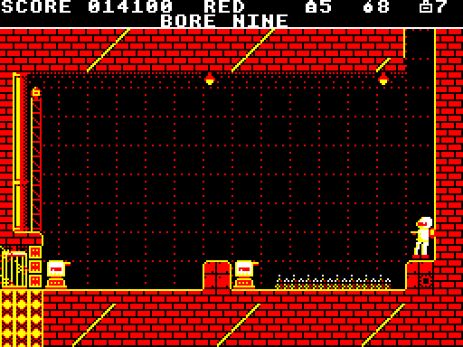</td></tr>
</table>

The deepest the Company dug, where the doublespar runs in veins and the
Blue is native. The swarm's crystal is alive here: on the beat its spans
draw back and grow again and its spikes sink and push up, flickering
first. It's all the Blue's, so in the Red it's a ghost, and the Red's way
is the Company's welded plates, crates and machines. Spar is the rock's
own crystal, in both phases, and a wall of it comes down to a grenade.
Crystal that's only scenery is drawn faint, crystal you can stand on has
a lit lip, and spar that breaks is cracked. A Sliver out of phase is its
outline and its eyes.

1. **THE MOTHER LODE.** The first lesson (above, in each phase). The way
   in is a tunnel, and a welded door at its end stops the Red. In the Blue,
   a span over the pit whose middle draws back and grows again, with a cell
   on it, and two Slivers that come over the pit; back to the Red on the
   landing, where crystal holds the way out, for the Trundler on the step.
2. **SPAR FACE.** A face of spar hangs from the roof, which one grenade
   brings down, and holds back a Gadfly. Shoot it through the gap under the
   face before you bring the face down. Beyond, the Blue's crystal on the
   floor keeps the Blue out, and only the Blue's span crosses the acid to
   the shaft down.
3. **THE ASSAY ROOM.** The assay furnace is the only footing over the
   acid, and in the Red it fires on the beat; in the Blue it's cold. It
   stops a sergeant's fire, and it's where to lob from. Past it, the Blue's
   crystal covers the floor, so land in the Red.
4. **SORTING TABLE.** Two rhythms on the picking belt, out of step: in the
   Red its hoppers pour hot ore onto it, and in the Blue crystal pushes up
   through it. The Red's road shoots a Trundler first; the Blue's climbs
   for a cell.
5. **THE CHANDELIER.** The Company's winch still lowers the chandelier on
   the beat and draws it up again. Ride its boss down to the low corridor,
   and step off before it goes back up; the corridor's floor is the Red's
   plates.
6. **SPLIT SEAM.** Two roads either side of a seam of spar: the sergeant's
   over it, the swarm's under it, where the crystal grows shut across the
   way on the beat.
7. **ECHO GALLERY.** Two walkways over the acid, one over the other, each
   the other's echo: where one is the Red's plates, the other is the Blue's
   crystal. Whichever phase you come in with, weave down and up between
   them. The Blue's crystal holds the door.
8. **LAST PAYDIRT.** A bridge that comes and goes too fast to cross, and
   high on the far wall, the Company's lever that stops it: climb to the
   welded ledge at its height to shoot it. Slivers over the bridge, and
   crystal grown over the shaft down.
9. **BORE NINE.** Two Drill Sergeants dug in round the drill, the Blue's
   crystal on the floor between them, a swarm in the drill shaft, and the
   shaft itself is the cage, straight into the Prism.

## Sector 5, inside the Prism

<table>
<tr><td>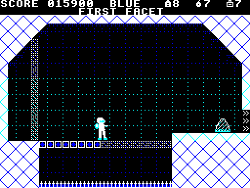</td>
<td>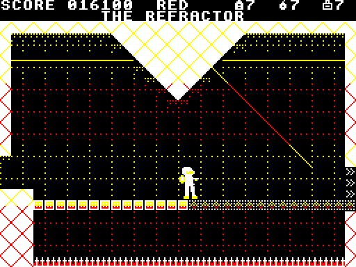</td></tr>
<tr><td>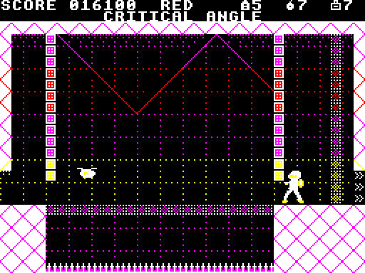</td>
<td>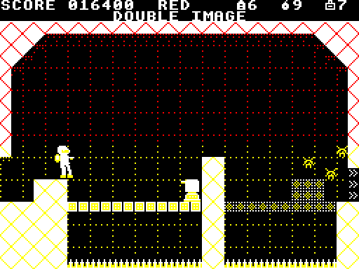</td></tr>
<tr><td>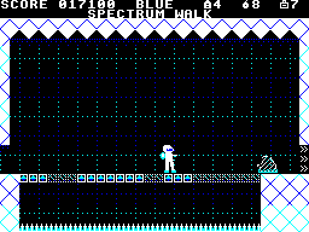</td>
<td>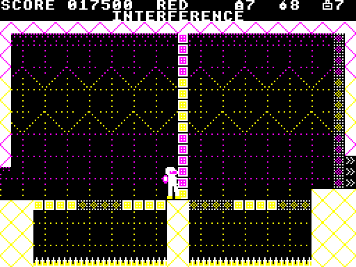</td></tr>
<tr><td>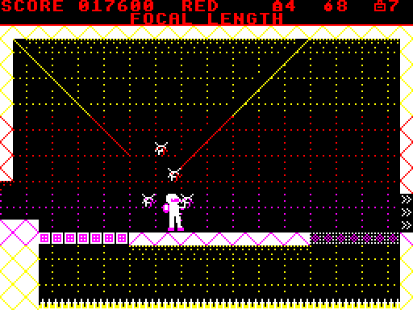</td>
<td>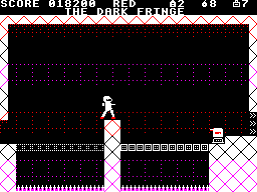</td></tr>
<tr><td>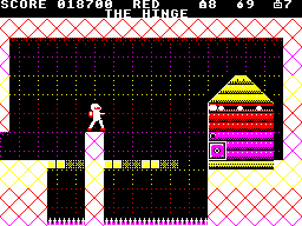</td>
<td>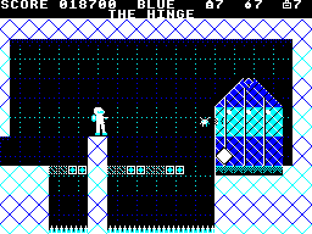</td></tr>
</table>

<<<<<<< HEAD
Past Bore Nine the rock stops: white faces, true angles, and bands of every
colour the Prism splits light into. For now the sector is its last room,
**THE HINGE**, at the Prism's focus: the one thing in the mine that's in
both phases at once, and what it is depends on which phase you're standing
in. Its floor is a patchwork of the Red's blocks and the Blue's, so every
shift is also a choice of where you'll be standing. It warns before it
fires, wherever you stand to fight it, and what you take from it stays
taken when you fall. How it dies is for you to find out; the end of the story is behind
it. The sector's other eight rooms come next.
=======
Past Bore Nine the rock stops: white faces, true angles, rays of light,
and bands of every colour the Prism splits light into. The floors are the
Red's blocks and the Blue's over white spikes, so you shift to stay
standing as much as to fight. Where one phase's blocks meet the other's,
the seam holds you in both: that's where to shift.

1. **FIRST FACET.** The lesson: the Blue's floor meets the Red's at a seam,
   with a cell on it. Two Slivers in the Blue, and a Trundler on the step
   at the way out.
2. **THE REFRACTOR.** The Prism's pulse: the middle of the floor turns from
   one phase to the other on the beat, flickering first. Wait on the seam.
3. **CRITICAL ANGLE.** A Gadfly between two walls of the Red's that hang
   short of the floor: shoot it from under one, where it can't come.
4. **DOUBLE IMAGE.** Two bays, each the other's image: a Drill Sergeant in
   the Red's, the swarm in the Blue's.
5. **SPECTRUM WALK.** Short runs of each phase's blocks: hop the other's.
6. **INTERFERENCE.** The whole floor turns phase, run by run. Cross it once
   in each.
7. **FOCAL LENGTH.** The swarm hangs where the beams meet, and won't let
   you shift beside it. Choose where it comes from.
8. **THE DARK FRINGE.** The light goes. A sergeant, a pillar, a swarm.
9. **THE HINGE**, at the Prism's focus: the one thing in the mine that's in
   both phases at once, and what it is depends on which phase you're
   standing in. It warns before it fires. How it dies is for you to find
   out; the end of the story is behind it.
>>>>>>> main

## The idea

- **SHIFT flips the phase.** Every palette band on the screen swaps at
  once, from the Red Phase's warm reds and yellows to the Blue Phase's
  cold blues and cyans. Blocks and enemies that belong to the other phase
  become dotted outlines: you walk through them, and they can't hurt you.
- A blaster, and grenades that crack armour and breakable walls.
- MODE 1 at 256x192 with palette bands driven by interrupts, after
  [Chuckie Egg 2](https://github.com/mattgodbolt/chuckie-egg-2-beeb)'s, so
  each band of a room has its own four colours.

## Make your own rooms

### ✎ [The level editor](https://mattgodbolt.github.io/redshift-beeb/editor/)

Paint tiles, place enemies and pickups, set the palette bands and the
exits, and flip between the phases to see both as the BBC draws them.
Press **Download rooms.txt** to keep your rooms. To play them, put the
file in place of `rooms/rooms.txt` in your own copy and build it (below).
See [`editor/README.md`](editor/README.md). To run the editor locally,
serve the repo's root (`python3 -m http.server`) and open
http://localhost:8000/editor/.

## Building it

[baron](https://github.com/waitingforvsync/baron) 0.6, Python 3 with
Pillow, and Node for the test harness (jsbeeb through
[jsbeeb-mcp](https://www.npmjs.com/package/jsbeeb-mcp)). Rendering the
music to WAVs needs NumPy too.

```sh
npm install
make            # build/redshift.ssd
make run        # boot it in jsbeeb, screenshot to shots/run.png
```

## Where things are

- `BRIEF.md`: where it started.
- `docs/journal.md`: what's been done, in order. `docs/decisions.md`:
  every design call, numbered.
- `gfx/tiles.txt`, `gfx/sprites.txt`: the art, as text.
- `rooms/rooms.txt`: the rooms, as text.
- `music/`: the music, as text (`music/instruments.txt` says how it's
  written). `make music-preview` renders each piece to a WAV in
  `build/preview/music`; `node tools/musiccap.mjs` records what the game
  itself plays, checks it against the scores, and renders that.
- `src/`: the game. `tools/`: the converters and the test harness.

## Licence

MIT: see [`LICENSE`](LICENSE).
