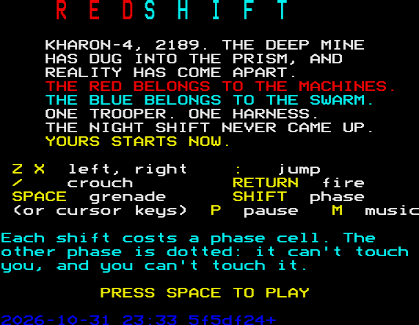
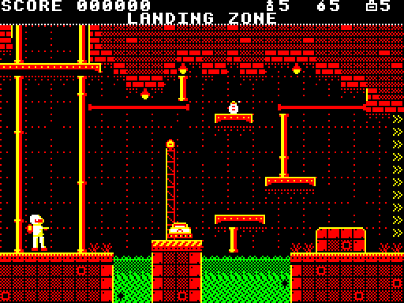
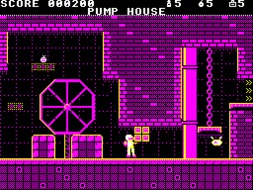
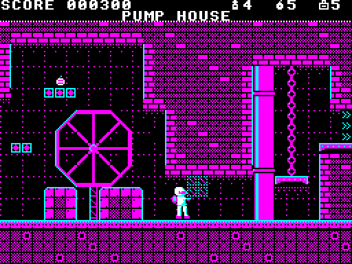
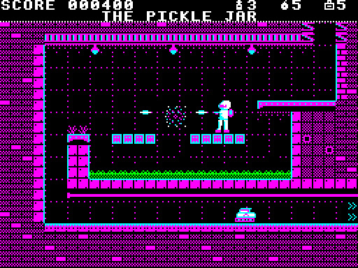
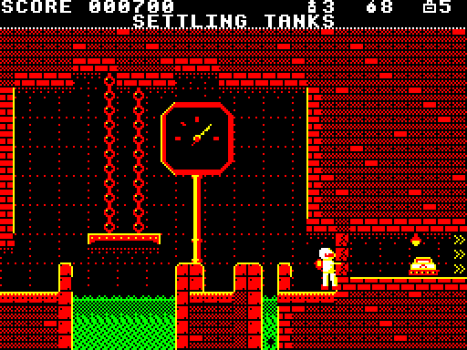
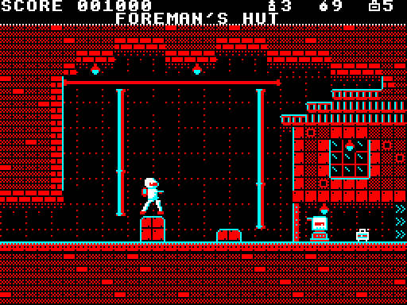
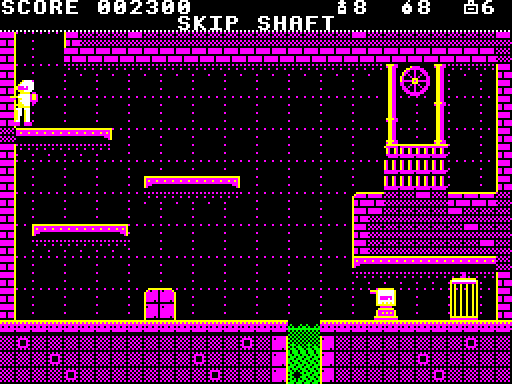

# REDSHIFT for the BBC Micro

*Future home of* an original flip-screen run-and-gun game for the BBC
Micro (a Model B with 16K of sideways RAM, or a Master 128), in 6502
assembly.

> Kharon-4, 2189. The colony's deep mine broke into the Prism, an alien
> engine that splits reality in two. The Red Phase is overrun by the
> Prism's war machines; the Blue Phase by its crystal swarm. Trooper Ash
> Calder wears the last working phase harness. Fight down through five
> sectors and shut the Prism off.

### ▶ [Play it in your browser](https://bbc.xania.org/?disc=github:mattgodbolt/redshift-beeb/redshift.ssd&autoboot)

A teletext title page, then Sector 1, THE LEACH WORKS: nine rooms from
the LANDING ZONE down to the cage in the SKIP SHAFT, and the first room of
Sector 2. Each **SHIFT** costs a phase cell. Blocks and enemies of the
other phase are dotted ghosts: you walk through them, and they can't touch
you. Green is always acid. A Drill Sergeant is armoured and dies only to a
grenade: lob one from a crate, or crouch under its fire and roll one at it.
The music follows the phase: listen to it change when you shift.

| Key | Does |
|---|---|
| Z / X (or ← →) | left / right |
| : (or ↑) | jump |
| / (or ↓) | crouch |
| RETURN | fire |
| SPACE | throw a grenade (crouching, roll it) |
| SHIFT | flip the phase |
| P | pause |
| M | music off / on |

## Sector 1, room by room

<table>
<tr><td></td>
<td></td></tr>
<tr><td></td>
<td></td></tr>
<tr><td></td>
<td></td></tr>
<tr><td></td>
<td></td></tr>
</table>

THE LEACH WORKS, where Ash starts, teaches one thing a room:

1. **LANDING ZONE.** Shoot the Trundler on the pad, hop the acid, and
   climb the girders over the pool to the way out.
2. **PUMP HOUSE.** A welded barricade blocks the corridor in the Red
   Phase, with a Gadfly beyond it to shoot under it. SHIFT, and in the
   Blue the barricade is a dotted ghost you walk through, while crystal
   ledges you couldn't stand on appear (above, the same moment in each
   phase).
3. **VAT ROW.** Blue crystal spans over the acid vats. The machines here
   belong to the Red, so in the Blue they're ghosts that can't touch you.
4. **THE PICKLE JAR.** A drop into a jar of acid, with Red plates across
   it: shift back, and the Gadfly over them is real again. Below, a
   Trundler in the drain has to be shot crouching.
5. **SETTLING TANKS.** A pack of fracture charges, and a cracked wall
   across the way on, with a Trundler behind it. One charge brings the
   whole wall down.
6. **FOREMAN'S HUT.** A Drill Sergeant holds the yard, and bolts spark off
   its armour. Lob a charge from a crate, or crouch under its fire and roll
   one. There's a trauma kit in the hut.
7. **THE CATWALKS** and 8. **SLURRY RUN.** Spending cells with care: Blue
   spans, Red plates, and Slivers that wake when you shift into their
   phase.
9. **SKIP SHAFT.** Down to THE CAGE, past a second sergeant. The cage takes
   Ash down to Sector 2, whose first room, the ENGINE SHED, is as far as
   the game goes for now.

## The idea

- **SHIFT flips the phase.** Every palette band on the screen swaps at
  once, from the Red Phase's warm reds and yellows to the Blue Phase's
  cold blues and cyans. Blocks and enemies that belong to the other phase
  become dotted outlines: you walk through them, and they can't hurt you.
- A blaster, and grenades that crack armour and breakable walls.
- MODE 1 at 256x192 with palette bands driven by interrupts, after
  [Chuckie Egg 2](https://github.com/mattgodbolt/chuckie-egg-2-beeb)'s, so
  each band of a room has its own four colours.

## Make your own rooms

### ✎ [The level editor](https://mattgodbolt.github.io/redshift-beeb/editor/)

Paint tiles, place enemies and pickups, set the palette bands and the
exits, and flip between the phases to see both as the BBC draws them.
Press **Download rooms.txt** to keep your rooms. To play them, put the
file in place of `rooms/rooms.txt` in your own copy and build it (below).
See [`editor/README.md`](editor/README.md). To run the editor locally,
serve the repo's root (`python3 -m http.server`) and open
http://localhost:8000/editor/.

## Building it

[baron](https://github.com/waitingforvsync/baron) 0.6, Python 3 with
Pillow, and Node for the test harness (jsbeeb through
[jsbeeb-mcp](https://www.npmjs.com/package/jsbeeb-mcp)). Rendering the
music to WAVs needs NumPy too.

```sh
npm install
make            # build/redshift.ssd
make run        # boot it in jsbeeb, screenshot to shots/run.png
```

## Where things are

- `BRIEF.md`: where it started.
- `docs/journal.md`: what's been done, in order. `docs/decisions.md`:
  every design call, numbered.
- `gfx/tiles.txt`, `gfx/sprites.txt`: the art, as text.
- `rooms/rooms.txt`: the rooms, as text.
- `music/`: the music, as text (`music/instruments.txt` says how it's
  written). `make music-preview` renders each piece to a WAV in
  `build/preview/music`; `node tools/musiccap.mjs` records what the game
  itself plays, checks it against the scores, and renders that.
- `src/`: the game. `tools/`: the converters and the test harness.

## Licence

MIT: see [`LICENSE`](LICENSE).
