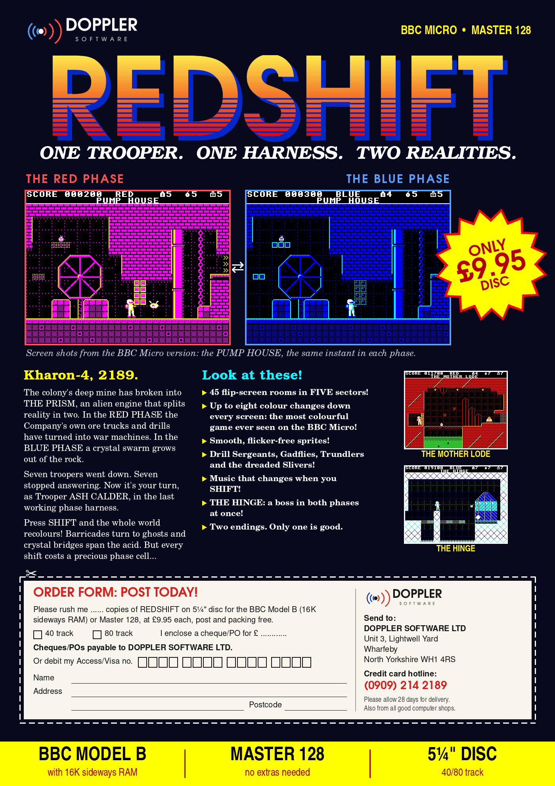
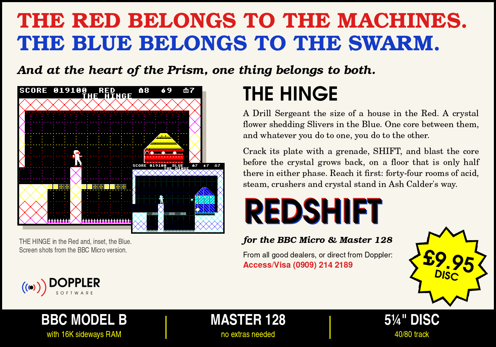
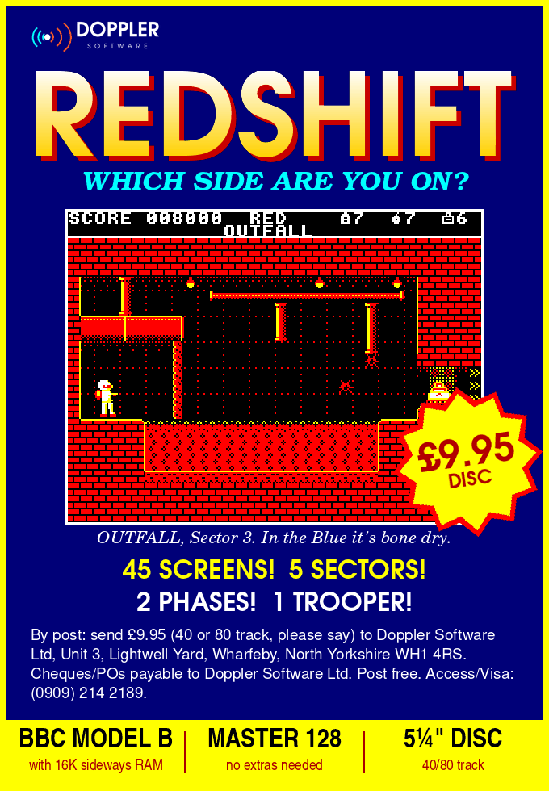

# REDSHIFT in the press, 1988 (imagined)

REDSHIFT was written in 2026, but it's a game for a machine whose heyday
was the 1980s. So here is the launch it would have had: adverts for the
monthly magazines, and the reviews that followed.

**None of this is real.** Doppler Software, its address and its phone
number are made up. The reviews are affectionate pastiches of Acorn User,
The Micro User and A&B Computing, written by AI agents. Each agent was
briefed as one magazine's reviewer, played the game in an emulator, and
formed its own opinion, gripes included. The reviewers' names are
invented too. The magazines never reviewed this game, and nobody who wrote
for them wrote these.

## The adverts

Made by [`tools/mkads.py`](../../tools/mkads.py) from the game's own screenshots.

## The reviews

- [Acorn User: "SEEING DOUBLE"](acorn-user.md), Overall 9.
- [The Micro User: "Seeing red, feeling blue"](micro-user.md), Overall 9.
- [A&B Computing: "Seeing Red (and Blue)"](ab-computing.md), 90%.

Their gripes are real, and they're worth reading as playtests:
- grenade lobs whose reach you have to learn;
- ghosts that are hard to see against the darker blues;
- a steep last sector and boss;
- no way to save your place.
