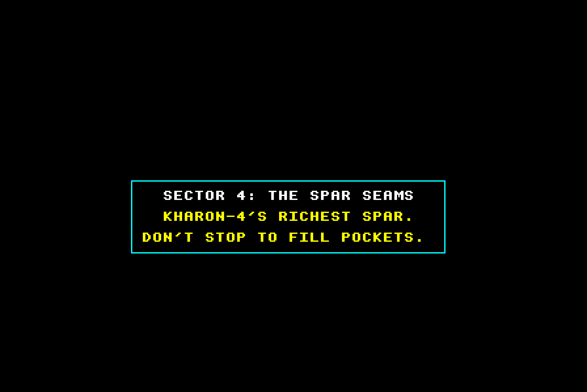
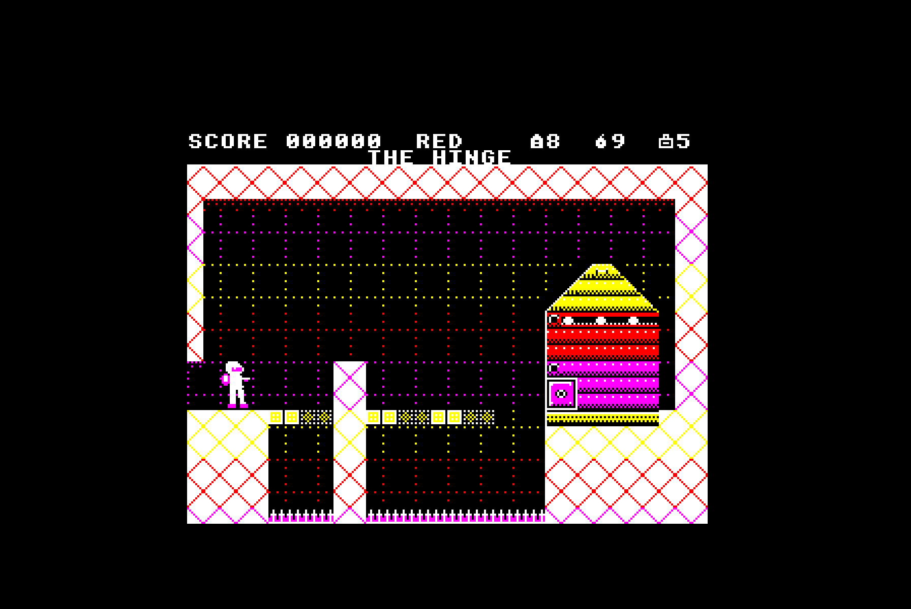
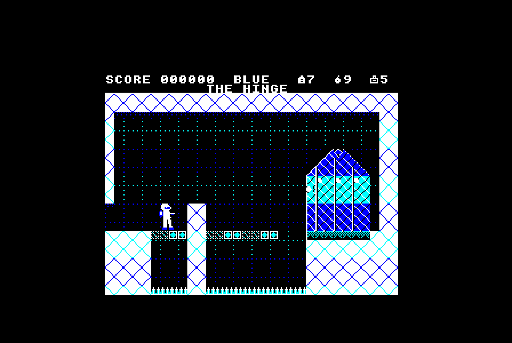

# Seeing Red (and Blue)

**Rhian Pellew straps on a phase harness and goes down the mine in Doppler's REDSHIFT**

| | |
|---|---|
| **Program** | REDSHIFT |
| **Publisher** | Doppler Software |
| **Price** | £9.95 |
| **Machines** | BBC Model B with 16K sideways RAM, or Master 128 |
| **Format** | 5¼" disc |

Every so often a game makes the whole A&B office gather round the review
machine. This month it was REDSHIFT, and the shooting wasn't the reason.
Press SHIFT and the whole screen changes colour at once, from foundry
reds and yellows to icy blues and cyans. The first thing everyone asked
was "How is it doing that in MODE 1?"

## Down the shaft

A teletext title page sets the scene, and sets it better than most.
Kharon-4, 2189: the mine has broken into the Prism, an alien engine that
splits reality in two. The war machines hold the Red Phase and a crystal
swarm holds the Blue. Seven troopers went down in phase harnesses and
none came back. You play the eighth, Trooper Ash Calder, and you have
five sectors to fight down through before you can switch the thing off.

Anyone who has played Exolon will feel at home with this flip-screen
run-and-gun: Z and X to run, colon to jump, RETURN to fire, SPACE for a
grenade. The twist is the phase shift. Whatever belongs to the other
phase is drawn as a dotted outline, and you walk through it while it
can't touch you. A welded barricade in the Red is a ghost in the Blue,
and a crystal bridge over the acid is solid in the Blue and gone in the
Red. Every shift costs a phase cell and you never have many, so each room
turns into a puzzle about when to spend one.

## How it's done

Here's my best guess at what's going on. The playfield is MODE 1,
narrowed to a squarer window, yet a room uses far more than four
colours: red brick at the top, yellow girders, green acid at the bottom.
I'd bet on a timer interrupt rewriting the palette at set scan lines, so
each band of the screen gets its own four colours. A phase shift then
just means loading another set of colours, which would explain why it
happens instantly. Green is always acid, and you soon learn to fear it.

The sprites move smoothly without flickering, which is rarer on the Beeb
than it should be. Even with a Gadfly bobbing past a Trundler and bolts in
the air, I saw no tearing. Everything must be put together off screen and
copied up in one go.

The sideways RAM is what makes it possible. Each sector has its own
graphics, machinery and tune. When Ash rides the cage down at a sector's
end, the drive whirs, the next sector loads, and a title card cracks a
two-line joke ("KHARON-4'S RICHEST SPAR. DON'T STOP TO FILL POCKETS.").
A short pause once a sector is a fair price, and a good deal kinder than
a tape multiload.

The music is excellent. Each sector has its own piece on the three tone
channels, and the tune follows the phase. When you shift, it changes key
and jumps an octave without losing its place: brooding in the Red, bright
and glassy in the Blue. I've not heard that done on the BBC before.

## The deep end

Sector 1, the Leach Works, teaches one idea per room, which is just how
it should be done. By Sector 4, the Spar Seams, the crystal is alive and
grows and shrinks on a beat, flickering first as a warning. In Spar Face
I crouched to shoot a Gadfly through the gap under a hanging wall of
spar, then brought the wall down with a grenade. It's satisfying when it
works and humbling when it doesn't.

Sector 5, inside the Prism, is where I came unstuck. The floors are
patchworks of Red and Blue blocks over white spikes, so a shift decides
what you stand on as well as what can hurt you. My first shift in the
Refractor dropped Ash onto the spikes. You're meant to wait on the seam
where the two phases' blocks meet. It's fair, but it's punishing.

Then there's the Hinge. In the Red it's a gun turret the size of a house,
and in the Blue it's a crystal flower that sheds Slivers at you. It's the
same object in each phase, which is a lovely idea, and the damage you do
survives a lost life. My grenades kept falling short of its plate, so
you'll have to find out how it ends for yourselves.

## Gripes

It's hard, and from the Sump onwards it's unforgiving: a wrong shift
usually costs a life as well as a cell. On the very first screen I walked
into a Trundler before I'd found the fire key. And owners
of a bare Model B will miss out, though I can't see how this could have
been done without the extra RAM.

## Verdict

REDSHIFT is the most technically assured Beeb game I've played this year,
and the cleverness isn't just for show. The phase shift isn't a gimmick
added to a shoot-'em-up: every room is built around it.

| | |
|---|---|
| **Graphics** | 9 |
| **Sound** | 9 |
| **Playability** | 8 |
| **Lastability** | 9 |
| **Value** | 9 |
| **OVERALL** | **90%** |

*If you have the sideways RAM, buy it. If you don't, this is the game
that will make you get some.*
