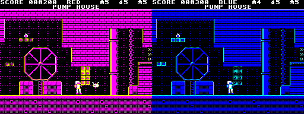
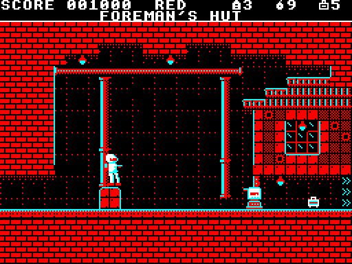
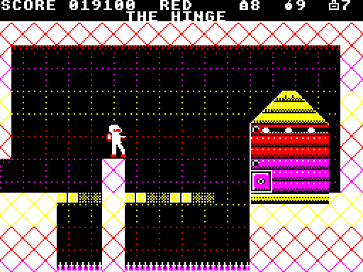

# SEEING DOUBLE

**Two worlds for the price of one, and both of them want you dead. Doppler
Software's REDSHIFT turns the Beeb's palette into a weapon, and Gordon
Pettifer squints at it through red and blue spectacles.**

*Games review by Gordon Pettifer*

---

Every so often a disc arrives on the Acorn User games desk that makes the
rest of the pile look tired. This month it was REDSHIFT, a flip-screen shoot-
and-jump game from newcomers Doppler Software, and the first thing it did was
make my monitor change colour.

The setting is Kharon-4, a mining moon in 2189, where the Company's deepest
drill has broken into something called the Prism. The Prism has split the
mine into two copies in the same rock: the Red Phase, overrun by war machines
built from the Company's own ore trucks and survey drones, and the Blue Phase,
where a crystal swarm grows over everything like frost. You are Trooper Ash
Calder, wearer of the last working phase harness, and your job is to fight
down through five sectors and switch the thing off. The sector cards ("ACID
GETS ORE OUT OF ROCK. IT ISN'T FUSSY ABOUT ROCK.") have more wit than most
games bother with.

*Same room, same moment. Left, the Red Phase: a welded barricade bars the
corridor. Right, one press of SHIFT later, and it's a dotted ghost.*

## The SHIFT key

Spectrum and Amstrad owners will spot the debt to Exolon at once: a lone
armoured trooper, a blaster, a satchel of grenades, one screen at a time. But
REDSHIFT has a trick Exolon never had. Press SHIFT and the whole screen swaps
phase: warm reds and yellows become cold blues and cyans in an instant, and
everything that belongs to the other phase turns into dotted outlines. You
walk straight through them, and they can't touch you. A barricade that stops
you dead in the Red is air in the Blue; a crystal bridge that carries you over
an acid vat in the Blue isn't there at all in the Red.

The catch is that every shift costs a phase cell, and cells are scarce. So
each room becomes a small puzzle in spending. Do you shift to dodge a Trundler,
or shoot it and save the cell for the bridge further on? The opening sector,
the Leach Works, teaches this beautifully, one idea per room: the Pump House
shows you the shift, the Settling Tanks show you a cracked wall and a pack of
fracture charges, and the Foreman's Hut introduces the Drill Sergeant, an
armoured gun on a plinth that shrugs off your blaster and dies only to a
grenade lobbed from a crate or rolled along the floor while you crouch under
its fire. By the cage at the bottom of the Skip Shaft I felt I'd been taught
the game rather than thrown at it, which is more than Citadel ever did for me.

*The Foreman's Hut. Ash on the crate, a charge ready for the Drill Sergeant
below. The trauma kit in the hut is worth the detour.*

## Under the bonnet

Technically it's a cracker. The screen is a narrowed Mode 1 with palette
changes split down the screen by interrupt, so each band of a room gets its
own four colours. The effect is a Beeb game with something like a dozen
colours on screen and no attribute mess, closer to Exile than to anything else
on the machine. Sprites are flicker-free, the rooms are packed with detail
(the Marshalling Yard's ore trucks, cranes and turntable are a treat), and
each sector loads from disc as Ash rides the cage down. It needs a Model B
with 16K of sideways RAM or a Master, and on that hardware it uses every byte.

Later sectors add machinery that moves on a beat, flickering just before it
does. The Sump's water boils only in the Red, so the Blue's dry bed becomes
the road, and inside the Prism the floors are a patchwork of both phases: you
shift as much to stay standing as to fight.

The music is three-channel chip work that follows the phase: shift, and the
tune shifts with you. It's a neat touch, and there's a proper title theme, but
after an hour of the in-game tune I reached for M.

*The Hinge, at the Prism's focus. Your reviewer lasted about four seconds on
a first visit.*

## Gripes

It's hard, and not always fairly so at first. My very first jump in the Landing
Zone went straight into the acid, and the jump wants to be judged from the
very lip of a ledge. Movement is deliberate rather than slick: Ash isn't the
nimble sprite Exolon's Vitorc is, and the animation runs at a sedate rate
that takes some getting used to after Ravenskull. Lives come back via trauma
kits, but a run of bad shifts can leave you stuck with no cells and a long
walk round. The status line, with the room name tucked under the score, is
cramped. And the final boss, the Hinge, is a stiff wall after forty-four rooms:
I was shot off my pillar inside four seconds, and working out how to kill it
took several evenings and a lot of muttering.

None of that stopped me going back. Repton has its puzzles and Exile its
caverns, but REDSHIFT does something neither does: it makes you look at every
screen twice. That's a real idea, carried right through forty-five rooms to a
proper ending, and it's the best arcade adventure I've seen on the Beeb this
year.

---

> **REDSHIFT**
> Doppler Software, £9.95 (5¼" disc)
> BBC Model B with 16K sideways RAM, or Master 128
>
> | | |
> |---|---|
> | Graphics | 9 |
> | Sound | 7 |
> | Playability | 8 |
> | Value for money | 9 |
> | **Overall** | **9** |
>
> Exolon with a split personality, and better for it. Tough, clever and
> gorgeous. Buy it, and keep a spare phase cell for the end.
