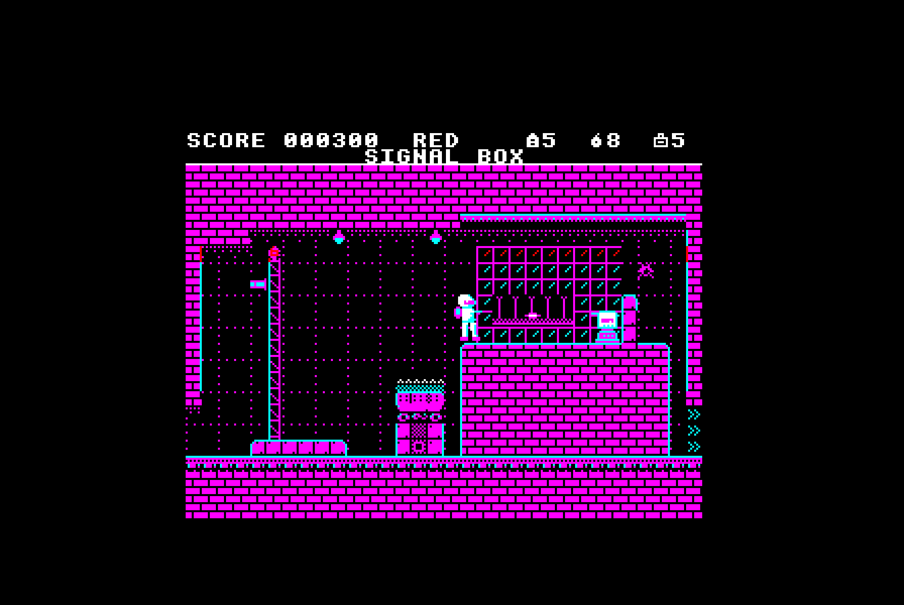
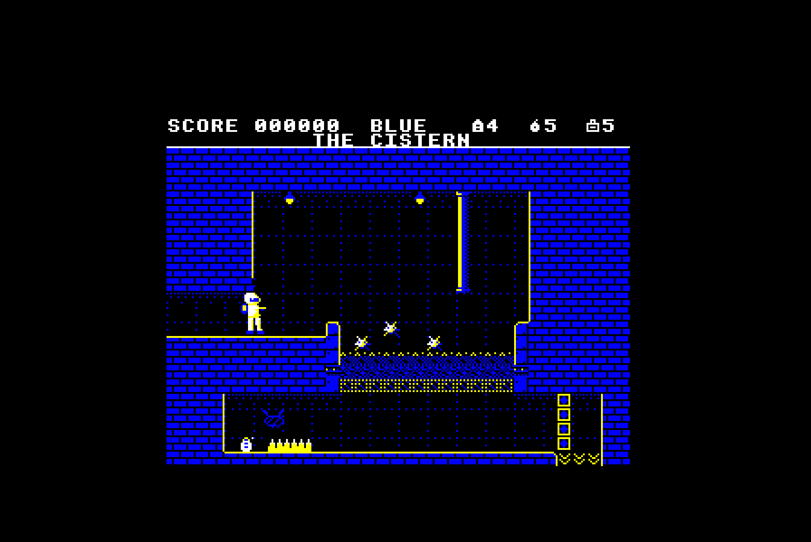
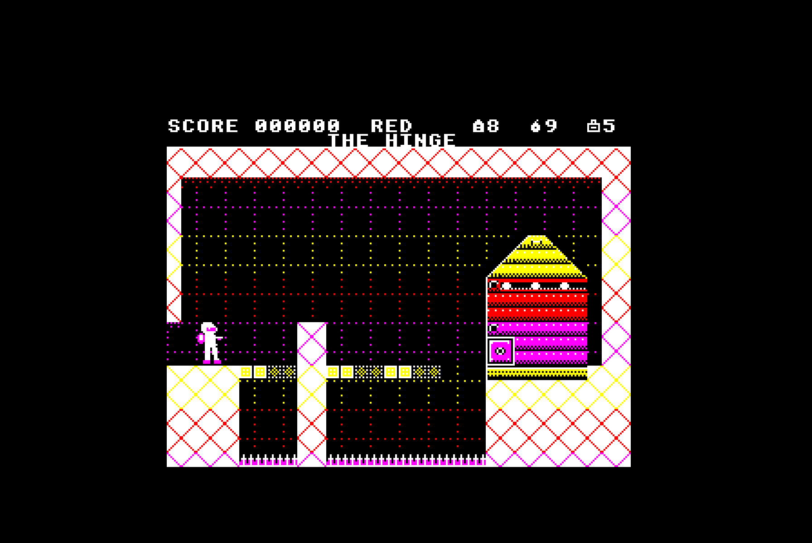

# GAMES REVIEW: Seeing red, feeling blue

**REDSHIFT** · Doppler Software · £9.95 (5¼" disc) · BBC Model B with 16K sideways RAM, or Master 128

*Reviewed by Gareth Pell*

THERE are two kinds of shoot-'em-up on the Beeb: the ones that look as if
they were written for something else and brought over in a hurry, and the
ones that look as if nothing else could have run them. REDSHIFT is
emphatically the second kind.

It's 2189, and a mining colony on Kharon-4 has dug into an alien engine,
the Prism, which has split reality into two halves sharing the same rock:
war machines in the Red Phase, a crystal swarm in the Blue. Trooper Ash
Calder wears the last working phase harness, and must fight down through
five sectors of nine screens each and switch the thing off.

So far, so Exolon, and fans of that game on other machines will feel at
home with the flip screens, the blaster, the grenades and the armoured gun
emplacements that only a grenade will crack. What lifts REDSHIFT out of
the pack is the SHIFT key.

Press it and every colour on the screen swaps at once, from furnace reds
and yellows to cold blues and cyans. Anything belonging to the phase you
have left becomes a dotted outline: a welded barricade that stopped you dead
a moment ago is now a ghost you stroll through, while crystal bridges you
couldn't stand on spring into being across the acid. Enemies of the other
phase can't touch you, and you can't touch them. Each shift costs a phase
cell, and there are never quite as many lying about as you would like, so
every room becomes a small puzzle about when to spend one.

It is a superb idea, and it's worked hard. In the Marshalling Yard, Sector
Two, the barricades are everywhere and the machinery moves on a beat, with
a flicker to warn you a moment before it does. In the Signal Box I spent a
good few lives lobbing grenades from an ore truck at the Drill Sergeant up
in its box, only to watch every one go off harmlessly against the
brickwork short of it. The answer, when it came, was to jump up into the
box, crouch under its fire and roll a grenade along the floor. Very
satisfying, but I'd have liked a clearer idea of how far a lob carries;
it takes some trial and error to learn.

Sector Three, the Sump, is where the game really grips. In the Red the
water boils and will kill you; shift to the Blue and the swarm has drunk
it, leaving a dry bed to walk along. The catch is that the Blue has its
own walls and its own Slivers, glittering crystal shards that home in on
you the moment you arrive. In the Cistern they rise out of the empty tank
in a cloud, and standing on the walkway picking them off one by one is
as tense as anything I've played this year. Shift back in the wrong spot
and you're in the soup, though the harness does sensibly refuse to drop
you into water or on top of an enemy.

Technically this is a remarkable piece of work. The screen is a narrowed
Mode 1, but the programmers change the palette part-way down the display,
so each band of a room has its own four colours and the result looks far
richer than Mode 1 has any right to. The sprites move without a trace of
flicker, and the scenery is full of detail: signal lamps, hazard-striped
steel, cracked spar walls waiting for a charge. There is music throughout
which, cleverly, changes with the phase, and it's a long way from the
usual beeps.

My grumbles are few, but real. The dotted ghosts of the other phase can be
hard to make out against the darker blue backgrounds. Sector Five, inside
the Prism itself, is hard: the floors are a patchwork of each phase's
blocks over spikes, and I lost a life within seconds of my first shift in
the Refractor by stepping off the edge of what had been a floor. You learn
the rooms, and the game is fair about it, but casual players may find the
later sectors a wall. And there's no save position, though ESCAPE does
let you give up a room and start it again for a life.

The other drawback is the hardware. You need 16K of sideways RAM, or a
Master 128, because the game keeps its art and rooms in the extra bank
and loads each sector from disc as the cage takes Ash down. Owners of a
plain Model B with a disc drive and nothing else are out of luck, and
tape owners can forget it altogether. Plenty of readers have a sideways
RAM board fitted by now, and the price of one has come down, but it's a
shame a game this good is out of reach of so many machines.

Against its BBC contemporaries REDSHIFT holds its own with anything. It
hasn't the sprawl of Exile or the brain-ache of Repton, but it is quicker
on its feet than either, and the phase trick gives it a depth that Exolon
on the Spectrum never had. At £9.95 on disc it's very good value indeed.

**SECOND OPINIONS**

*Lynne Ashworth:* "I've never seen colours like these from a Beeb. The Sump
is a masterpiece of level design, and the boss is enormous. Hard, though:
I never got past the Prism's second room."

*Phil Garside:* "The lob is too fussy for me, and I died on the Signal Box
more times than I'll admit. But the moment the screen flips from red to
blue is one I'll remember."

| | |
|---|---|
| **Sound** | 8 |
| **Graphics** | 9 |
| **Playability** | 8 |
| **Value for money** | 9 |
| **Overall** | **9** |
